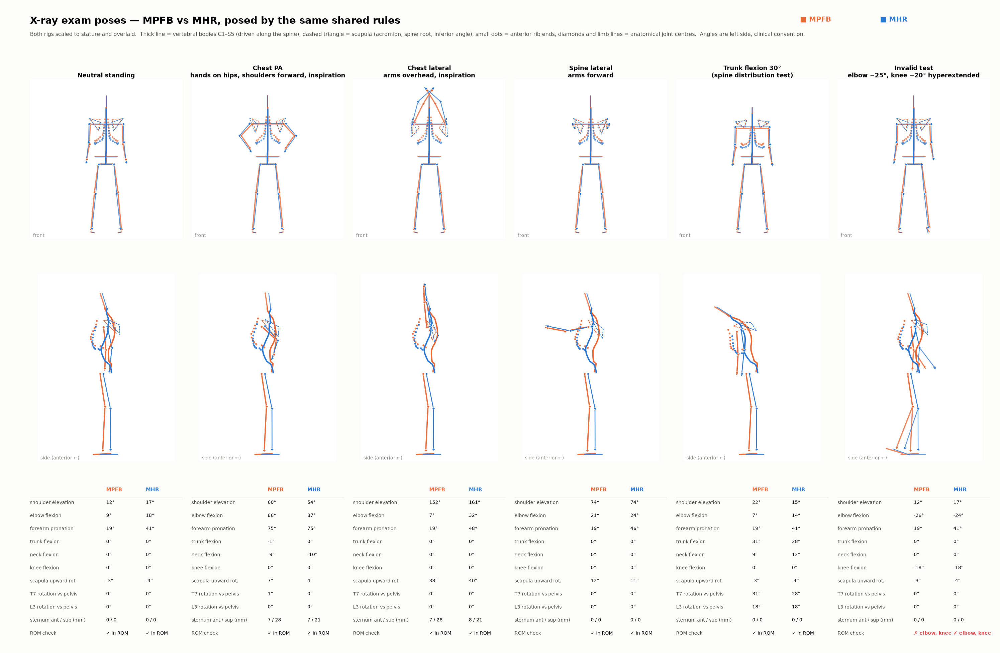
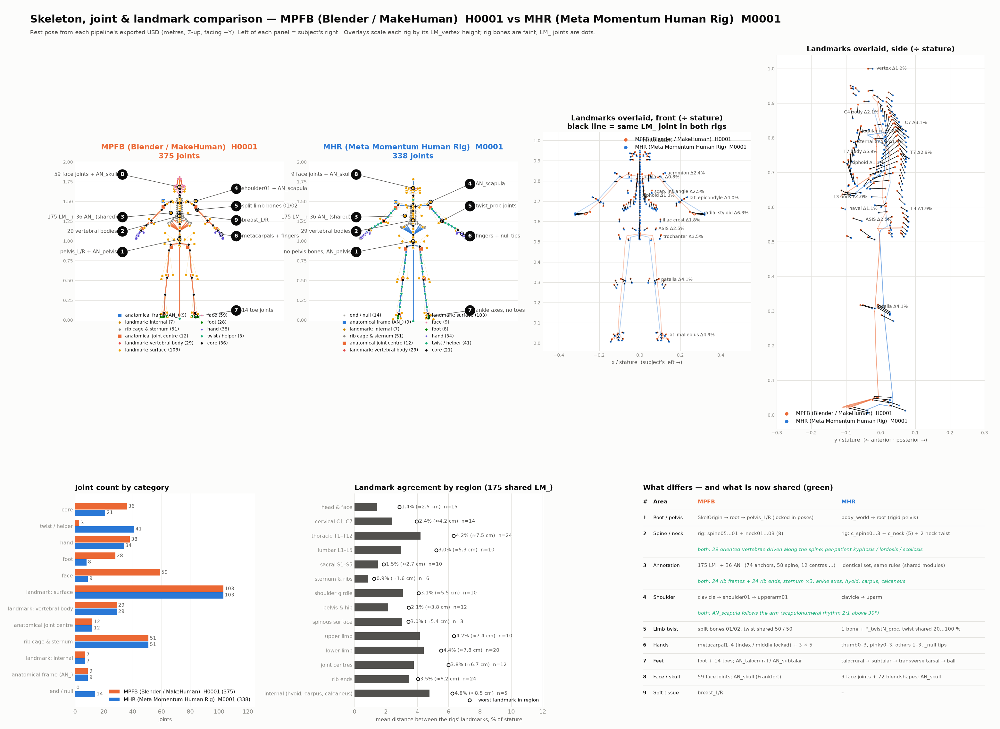

# 13. MPFB vs MHR: skeleton, landmarks and X-ray exam poses

This pipeline has a sibling, **`mhr-synthetic-human`**, which builds the same synthetic patients from
Meta's **Momentum Human Rig (MHR)** instead of MPFB. Both pipelines share their anatomy and posing
code, so their outputs can be compared joint for joint. This page records how the two compare, as of
2026-10-26.





*Both figures: the same subject (male, 44 y, 178 cm, 104 kg, BMI 32.8) built by both pipelines. Orange =
MPFB (H0001), blue = MHR (M0001). Overlays are scaled to stature.*

## 13.1 Shared code

Four modules are **copied identically** between `sdg_humans/` and `mhr-synthetic-human/mhr_humans/`.
Change them in both places.

| Module | Contents |
|---|---|
| `landmark_rules.py` | Anchor rules (74 surface anchors from stature fractions and reference joints), ISB frames (skull, thorax, pelvis, scapula), vertebra axes |
| `anatomy_rules.py` | Joint centres, rib cage and sternum, ankle axes, hyoid / carpus / calcaneus / internal patella, per-patient spinal shape |
| `pose_rules.py` | Exam poses (IK), coupled motion, breathing, joint locks, clinical angles, range-of-motion table and validator |
| `pose_usd.py` | Reads the skeleton from USD and writes the exam poses as a UsdSkelAnimation plus a JSON report |

`landmark_math.py` (spine distribution) is shared too. Rig-specific settings are limited to
`configs/landmarks.yaml` (parent bones) and `configs/poses.yaml` (joint roles).
Tests for the shared code: `tests/test_landmark_rules.py` and `tests/test_anatomy_pose_rules.py`.

## 13.2 Joint inventory

| | MPFB | MHR |
|---|---:|---:|
| Rig joints | 164 (163 deforming + `SkelOrigin`) | 127 |
| `LM_` annotation joints | 175 | 175 |
| `AN_` oriented frames | 36 | 36 |
| **Total** | **375** | **338** |

The 211 annotation joints are **identical in both rigs** (names, rules, axis convention X anterior,
Y superior, Z subject right; see [06 Landmarks](06_landmarks.md#68-derived-joints-spinal-shape-and-exam-posing-2026-10-26)).
All remaining differences are in the rigs themselves:

| Area | MPFB | MHR |
|---|---|---|
| Pelvis | `pelvis_L/R` move independently in the rig (locked by `pose_exams.py`) | legs on `root`: rigid, as in a real pelvis |
| Spine / neck | `spine05…01` + `neck01…03` (8 bones) | `c_spine0…3` + `c_neck` (5) + 2 neck twist joints |
| Shoulder | clavicle → `shoulder01` → upperarm01 | clavicle → uparm (no scapular bone) |
| Elbow / knee | free 3-axis joints | 1-axis hinges in the model |
| Limb twist | split bones (`upperarm01/02`, `lowerarm01/02`, …) | one bone + procedural `*_twistN_proc` joints |
| Hands | `metacarpal1–4` movable (index / middle locked in poses) + 3 phalanges × 5 | thumb0–3, pinky0–3, index / middle / ring 1–3 (index / middle metacarpals rigid, as in anatomy) |
| Feet | `foot` + 14 toe joints, no ankle sub-axes | talocrural → subtalar → transverse tarsal → ball, no toes |
| Face | 59 face joints | 9 joints + 72 expression blendshapes |
| Joint limits | none in the rig | 198 min/max limits in the model (exported per run as `mhr_joint_limits.json`) |
| Mesh | 13 380 body vertices | 73 639 vertices (LOD 0) |
| Body shape | artist-made macro targets | shape space learned from body scans |

## 13.3 Both rigs vs a real skeleton

Neither rig is an anatomical skeleton. Both are **deformation rigs**: their joints exist to bend
the skin. The annotation layer (13.2) fills most of the anatomical gaps in both:

| Real anatomy | Rig layer | Annotation layer (both) |
|---|---|---|
| 24 vertebrae + sacrum, motion spread over every level | 4–8 spine / neck joints | 29 oriented vertebral bodies, driven smoothly along the rig chain in poses |
| 12 rib pairs, sternum, breathing | none | `AN_rib01…12`, rib ends, 3 sternum segments, breathing parameter |
| Scapula gliding on the thorax (scapulohumeral rhythm 2:1) | MPFB `shoulder01`, MHR none | `AN_scapula` + 4 scapular landmarks rotate with arm elevation |
| Joint centres deep in the bone | pivots placed for skinning | `LM_*_centre_*` from published formulas (Harrington, Rab, ISB midpoints) |
| Ankle and subtalar axes | MHR only | `AN_talocrural`, `AN_subtalar` (Inman axis) |
| Ligament-limited joint ranges | MHR only (lost in USD) | range-of-motion validator on every pose |
| Individual spinal shape | none | per-patient kyphosis / lordosis / scoliosis (internal skeleton) |

Gaps that remain in both: no real bone meshes (MPFB has schematic ones, see [11](11_anatomy.md); MHR
has none), no organs, and the skin doesn't follow the annotation-only motion (ribs, scapula, vertebrae).

## 13.4 Results on the matched subject

### Exam poses (`scripts/pose_exams.py`, identical rules for both rigs)

| Pose | Shoulder elevation (MPFB / MHR) | Elbow flexion | Scapular upward rotation | Sternum forward / up (breathing) | ROM check |
|---|---|---|---|---|---|
| Neutral | 12° / 17° | 9° / 18° | −3° / −4° | – | ✓ / ✓ |
| Chest PA (hands on hips, shoulders forward, inspiration) | 60° / 54° | 86° / 87° | 7° / 4° | 7 / 28 mm, 7 / 21 mm | ✓ / ✓ |
| Chest lateral (arms overhead, inspiration) | 152° / 161° | 7° / 32° | 38° / 40° | 7 / 28 mm, 8 / 21 mm | ✓ / ✓ |
| Spine lateral (arms forward) | 74° / 74° | 21° / 24° | 12° / 11° | – | ✓ / ✓ |
| Trunk flexion 30° | – | – | – | – | ✓ / ✓ |
| Invalid test (elbow −25°, knee −20°) | – | −26° / −24° | – | – | **flagged / flagged** |

- Wrist targets are reached exactly (0 mm IK error) in every pose for both rigs.
- In trunk flexion, rotation increases smoothly along the spine (L3 18° / 18°, T7 31° / 28°) instead of
  jumping at the rig joints.
- MPFB's arms are shorter relative to its head height, so in the arms-overhead pose its elbows end up
  almost straight (7° vs 32°).

### Rig pivots vs anatomical joint centres (rest pose, left side)

| Joint | MPFB | MHR |
|---|---:|---:|
| Hip | 68 mm | 42 mm |
| Shoulder | **33 mm** | 50 mm |
| Elbow | 35 mm | **18 mm** |
| Wrist | 37 mm | **13 mm** |
| Knee | 32 mm | 31 mm |
| Ankle | 27 mm | **17 mm** |

MHR's pivots sit closer to anatomy at 4 of 6 joints. The anatomical centres are estimated from skin
landmarks (about ±1–2 cm), so this is indicative only.

### Spinal shape

| | Before (from the surface) | Sampled target | After |
|---|---|---|---|
| MPFB H0001 | kyphosis 13°, lordosis 43° | 39° / 48° | 39.3° / 48.0° |
| MHR M0001 | kyphosis 22°, lordosis 32° | 24° / 58° | 23.4° / 57.9° |

MPFB's surface-derived spine is unrealistically flat (13° kyphosis, against roughly 20–45° in adults);
the per-patient reshape corrects this.

### Cross-rig landmark agreement

Distance between the two rigs' landmarks as a percentage of stature (1 % ≈ 1.8 cm): sternum 0.9,
head 1.4, sacrum 1.5, pelvis 2.1, cervical 2.4, shoulder girdle 3.1, rib ends 3.5, joint centres 3.8,
thoracic 4.2, upper limb 4.2, lower limb 4.4. Trunk-surface landmarks stay within 1.8–2.2 % in every
exam pose. The thoracic gap partly reflects the different sampled kyphosis (39° vs 24°).

## 13.5 Which rig to use

| Need | Better | Why |
|---|---|---|
| Production X-ray SDG today | **MPFB** | gowns, hair, footwear and bone meshes are all in place |
| Age range (elderly, paediatric) | **MPFB** | age macro; MHR has no age control |
| Realistic body shape and soft tissue | **MHR** | scan-learned shape space, 5.5× denser mesh |
| Joint mechanics in exam poses | **MHR** | hinge elbows and knees, anatomical ankle, 198 limits, pivots closer to anatomy |
| Throughput | **MHR** | about 2 s per human vs about 100 s in Blender |
| Annotations (landmarks, frames, poses) | either | identical layer in both |

Recommendation: keep MPFB as the production pipeline. Move to MHR as primary once it has the gown
and bone meshes, and measure both against reference data (ANSUR II heights, CT skin-to-bone depths)
before deciding.

## 13.6 Reproducing the comparison

```bash
# MPFB (this project)
.venv/bin/python scripts/run_pipeline.py --count 1
.venv/bin/python scripts/pose_exams.py <run>/humans/H0001/H0001.usd

# MHR (../../mhr-synthetic-human), same subject
pixi run python scripts/run_pipeline.py --set "population.subjects=[{sex: male, height_cm: 178, weight_kg: 103.9, age: 44}]"
pixi run python scripts/pose_exams.py output/run-*/humans/M0001/M0001.usd
```

The comparison scripts (`extract.py`, `render_v3.py`, `render_poses.py`, `results_v3.py`) and the raw
results (`results_v3.json`, the exam-pose reports) are in
`mhr-synthetic-human/output/skeleton_comparison/`.
