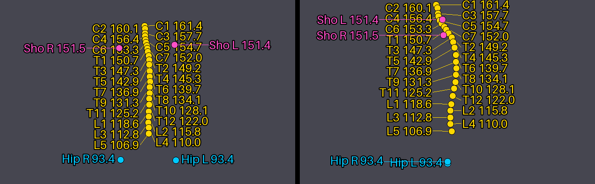

# 10. Image capture

During every visit the room cameras record RGB and depth frames with Replicator inside Isaac Sim. The
configuration is in `configs/capture.yaml`. `--no-capture` animates only.

## 10.1 Output

```
output/sdg/run-20261021-193000/SD.00003/
├── sd_info.json                     capture.groups (e.g. side: LEFT), cameras, fps, sim_fps, every_n_frames
└── CHEST/
    ├── timeline.txt
    ├── frames.csv                   frame, time_s, step, op, projection, fov_light
    ├── annotations/000001.json …    vertebra, hip, shoulder heights (cm) of the frame (10.5)
    ├── FAR_LEFT/RGB/000001.png …            CeilingCam_FarLeft
    ├── FAR_LEFT/Depth/000001.png …          uint16, millimetres (npy: float32 metres)
    ├── FAR_LEFT/Depth_Preview/000001.png …  8-bit greyscale, for viewing only
    ├── FAR_RIGHT/{RGB,Depth,Depth_Preview}/
    ├── CHECK_IN/…                           only when enabled (off by default, see 10.2)
    ├── FRONT/{RGB,Depth,Depth_Preview}/     RealSense_D455_Front (tube head)
    ├── TOP/{RGB,Depth,Depth_Preview}/       RealSense_D455_Top (above the detector)
    └── LEFT/{RGB,Depth,Depth_Preview}/      RealSense_D455_Left  (or RIGHT, see 10.3)
```

With more than one room per run, each room gets its own folder: `CHEST/R0001/FAR_LEFT/RGB/…`.

* **Frames** are numbered from 1 in each visit, in the same numbering for every camera, with `fps` images per
  second of simulated time (default 2). The simulation runs at `isaac.fps` (30), so `fps: 2` records every 15th
  simulated frame; `fps` must divide `isaac.fps` (30, 15, 10, 6, 5, 3, 2 or 1). `frames.csv` gives each frame's
  simulated time (the `t=` of `timeline.txt`), the running step (`step`, `op`, `projection`), and whether the FOV light is on.
* **RGB** is PNG (or JPG, `rgb_format`) at the camera's own resolution (`sdg:resolution`; for example the D455s
  record 800 × 1280 colour and 720 × 1280 depth, portrait) or at `resolution: [w, h]`.
* **Depth** is the distance to the image plane: `png16` uint16 in millimetres (default), or `npy` float32 in metres.
  Pixels with no hit are 0. These are measurements, not pictures: in an image viewer a `png16` depth image looks
  black, because 2 m is stored as 2000 of 65535 (3 % grey). Read it with e.g.
  `np.asarray(Image.open(p)) / 1000.0` (metres).
* **Depth_Preview** (`depth_preview: true`) is the same depth as a viewable 8-bit PNG: near (`depth_preview_range_m[0]`,
  0.3 m) = white, far (`[1]`, 8 m) = dark grey, no hit = black. The range is fixed, so frames and cameras are
  comparable. For looking only; use `Depth` for training. D455 rigs take depth from their `_Depth` camera (depth optics) and colour from their
  `_RGB` camera. The ceiling cameras use one camera for both.
* Before frame 1 the capture waits until every camera delivers images, and a frame is written only when all its
  streams have data, so every camera has the same gap-free frames `000001 … N`, one row each in `frames.csv`.
* Before Isaac starts, the pipeline estimates the capture size (about 0.7 MB per camera per frame with png16 depth and
  the preview; a chest visit with 6 cameras is about 0.4 GB at 2 fps, about 6.5 GB at 30 fps) and stops with an error if the disk is too small.
* Asynchronous rendering is switched off while capturing, so each image belongs to the frame it is labelled with.
  Images are written by `write_threads` background writers, so the simulation does not wait on the disk.

## 10.2 `capture.yaml`

| Key | Default | Meaning |
|---|---|---|
| `enabled` | true | capture during the visits (`--no-capture` turns it off) |
| `fps` | 2 | images per second of simulated time, per camera; must divide `isaac.fps` (30 = every simulated frame, 15, 10, 6, 5, 3, 2, 1) |
| `start` | spawn | `spawn` = the whole visit; `detector_marker` = only from the idle on the detector marker through the last projection |
| `cameras` | 7 (CHECK_IN off) | output folder name → `{camera: <prim under /World/Room/Cameras>}` or `{rig: <D455 rig>}`; `group` makes it part of a camera group; `enabled: false` turns the camera off (see below) |
| `groups` | `side: {LEFT: 0.5, RIGHT: 0.5}` | per group, each SD records exactly one camera; shares across the dataset |
| `streams.rgb` / `streams.depth` | true / true | which images to write |
| `rgb_format`, `jpg_quality` | png, 95 | |
| `depth_format` | png16 | `png16` (uint16 mm, lossless to 1 mm, about 6× smaller) or `npy` (float32 m) |
| `depth_preview` | true | also write `Depth_Preview/` (8-bit greyscale PNG for viewing) |
| `depth_preview_range_m` | [0.3, 8.0] | distances mapped to white … darkest grey in the preview |
| `resolution` | native | each camera's `sdg:resolution`, or `[width, height]` for all |
| `write_threads` | 6 | parallel image writers |

**Turning a camera off.** Add `enabled: false` to its entry; it gets no folder and no images, and is left out of
`sd_info.json → capture.cameras`. The check-in room camera is off by default:

```yaml
cameras:
  CHECK_IN:  {camera: CeilingCam_CheckIn, enabled: false}     # remove `enabled: false` to record it again
```

From the command line: `--set capture.cameras.CHECK_IN.enabled=true` (or `=false` for another camera). A camera in a
group (LEFT / RIGHT) can only be turned off together with its share: `groups: {side: {LEFT: 1.0, RIGHT: 0.0}}` and
`RIGHT: {…, enabled: false}`; otherwise the config check stops with an error. Turning all cameras off is an error
too (use `--no-capture`).

## 10.3 Camera groups: left / right D455

The two side-on D455 cameras near the X-ray machine are a group (`side`). Each SD records one of them, and the choice
keeps the whole dataset at the configured shares, **across runs**:

* before a run, the pipeline counts the choices recorded in existing `output/sdg/run-*/SD.*/sd_info.json →
  capture.groups` (all runs);
* each new SD takes the camera that is furthest below its share (ties go to the first camera in the config).

Examples with `{LEFT: 0.5, RIGHT: 0.5}`: 2 patients in one run → one LEFT and one RIGHT. If SD.00001–SD.00003 are
LEFT, RIGHT, LEFT, the next SD records RIGHT. With `{LEFT: 0.75, RIGHT: 0.25}`, 8 SDs → 6 LEFT and 2 RIGHT. The
console shows each SD's cameras (`SD.00003 records FAR_LEFT, …, LEFT`).

Other groups can be added the same way, e.g. two ceiling cameras with `group: ceiling` and
`groups: {ceiling: {FAR_LEFT: 0.5, FAR_RIGHT: 0.5}}`.

## 10.4 Run time and size

Rendering 6–9 render products every frame on one GPU is the slow part. Measured on this machine (Tesla T4), see the
README for the numbers of the last test run. Disk: a PNG of 1280 × 720 is about 1–1.5 MB and a depth `.npy` of
720 × 1280 is 3.7 MB, so one camera at 30 fps for a 52 s visit (about 1,560 frames) takes several GB. Use a lower
`fps`, `streams.depth: false`, `depth_preview: false`, `depth_format: png16` or fewer cameras to reduce it.

## 10.5 Anatomy annotations

Configured in `configs/annotations.yaml` ([03 §3.7](03_configuration.md#37-annotationsyaml)). This needs Z-Anatomy
humans. Humans with the MPFB rig have no vertebra bones and get no annotations (a warning per human).

**Frame numbers.** Every captured frame has one number `000001 … N` per visit. It is shared by every camera's
`RGB/<frame>.png`, `Depth/<frame>.png`, the `frames.csv` row, `annotations/<frame>.json` and the label drawn in the
image's corner.

**`annotations/<frame>.json`**: heights in **cm above the room floor** (stage z = 0), read from the animated
skeleton at the moment the frame is captured:

```json
{"frame": 123, "image": "000123", "time_s": 61.5, "step": 14, "op": "fov", "projection": "PA", "fov_light": 1,
 "units": "cm", "reference": "room floor (z = 0)",
 "vertebrae": {"C1": 161.4, "C2": 160.1, "...": 0, "L5": 106.9},
 "hip": {"left": 93.4, "right": 93.4},
 "shoulder": {"left": 151.4, "right": 151.5}}
```

| Value | Point |
|---|---|
| `vertebrae.C1 … L5` | mid-point of each vertebra: bounding-box centre of its Z-Anatomy bone mesh `bone_vertebra_<level>`, moving with joint `vertebra_<level>` |
| `hip.left/right` | greater trochanter (`<id>.json → anatomy.points_m.greater_trochanter_l/r`), moving with `femur_L/R` |
| `shoulder.left/right` | acromion (`anatomy.points_m.acromion_l/r`), moving with `scapula_L/R` |
| `step`, `op`, `projection`, `fov_light`, `time_s` | the same as the frame's `frames.csv` row |

The points are stored once per human as offsets in their joint's bind frame (host, `sdg_xray/annotations.py`). The
pipeline log prints each human's rest heights (`rest heights cm: C7 152.0, T7 136.9, L5 106.9, hip 93.4 / 93.4, …`).
In Isaac, every captured frame reads the posed world matrices of these joints the way NVIDIA's own behavior tests do
(usdrt / Fabric: the SkelAnimation driving the skeleton, rest transforms for joints it does not drive, and the
SkelRoot's world matrix). The agent API cannot be used because it only knows the retarget tags, not the vertebrae or
the scapula. On the first frame the log compares `femur_L` and `skull` with the agent's own `LeftLeg` and `Head`
(`annotations: femur_L vs agent LeftLeg: 0.3 cm`). More than 2 cm is a warning.

**Overlay in the RGB images** (`overlay.enabled: true`, default). Each point is projected with that frame's camera
view and projection, read from the USD camera prim (`UsdGeom.Camera` → `Gf.Frustum`, so the moving TOP / FRONT
cameras stay correct; the Replicator `camera_params` annotator crashes Isaac 6.2 in GUI runs). It is drawn as a dot
with its label and height in cm. Vertebra labels alternate between a column left and a column right of the spine,
hip and shoulder labels go on the outer side, and labels moved away from their dot get a thin leader line. The frame
number is drawn in the top-left corner. The points are internal anatomy, so they are always drawn, like an X-ray
overlay. Depth images are not drawn on.



> **The RGB images with the overlay are not clean training images.** Use `--no-overlay` (or
> `--set annotations.overlay.enabled=false`) for clean images; the JSON files are written either way.
> `sd_info.json → capture.overlay` records which it was, and the log prints `annotations drawn into RGB: on|off`.
