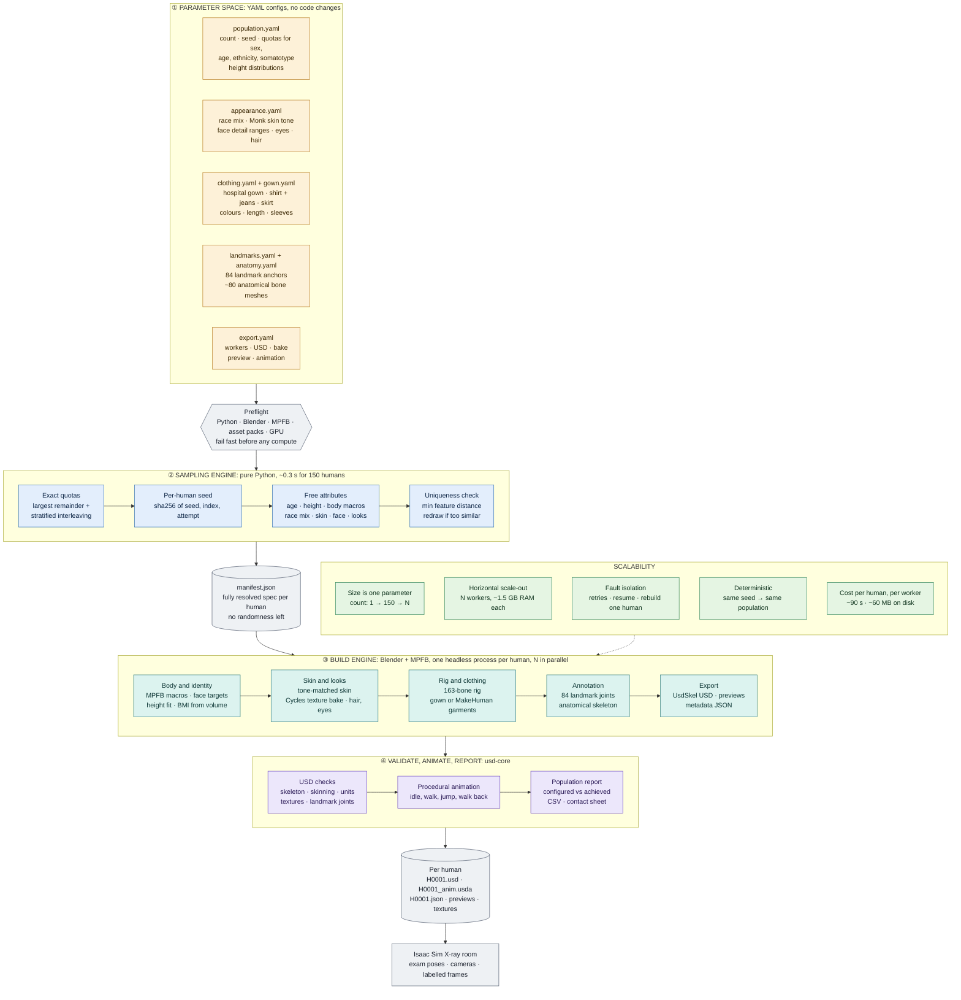

# 12. Pipeline diagram (high level)

How the synthetic-patient generator turns a parameter file into a population of distinct,
rigged, landmark-annotated humans for Isaac Sim, and how the same pipeline scales from 1 to N.

## Reading the diagram

* **Parameterized.** Every property of a human (sex, age, ethnicity, skin tone, build, height,
  face, clothing, landmarks) comes from a distribution or quota in a YAML file. Changing the
  population means editing numbers, not code.
* **Two engines, one contract.** The sampling engine (pure Python) resolves all randomness into
  `manifest.json`. The build engine (Blender + MPFB) only reads that manifest, so a build depends
  on its manifest entry and the asset files alone.
* **Scalable.** Each human is an independent Blender process. Workers run in parallel, a crash
  affects one human only, and `--resume` / `--only` continue or rebuild without resampling.

Details: [01 overview](01_overview.md) · [04 pipeline](04_pipeline.md) ·
[05 body and identity](05_body_and_identity.md).
